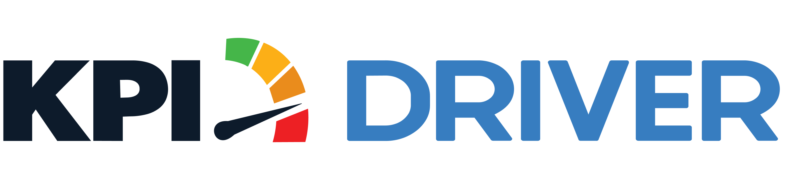

<p align="center">
  
  &nbsp;&nbsp;&nbsp;&nbsp;
  
</p>

<h1 align="center">Universal Team Hub</h1>

<p align="center">
  <strong>One live hub for every department's tasks, owners, and files across TCHB and KPI Driver.</strong>
</p>

<p align="center">
  
  
  
  
</p>

---

## What It Does

Plan the work, assign it, and watch it move — by department, in real time.

- **Departments** — TC, DISPO, ACQ and OPS. Everyone's personal list belongs to their main department.
- **Roles** — Managers see everything; Team Leaders see and assign within their departments; Members see their own list (plus their department when a manager turns that on).
- **Shared Work** — own a subtask on anyone's task and that task shows in your list, with the parts you don't own blurred.
- **Tasks & Subtasks** — check off subtasks and the main task closes itself, or complete the whole task in one click.
- **Clear Statuses** — Not Started, In Progress, Done, with the date each one started and finished.
- **Files** — attach documents to any task or subtask; the Files button shows every task folder in the current view.
- **Notes** — leave notes on tasks and subtasks, with who wrote them and when.
- **Two Company Boards** — TCHB and KPI DRIVER, each with its own tasks, progress, and brand look; access is set per person.
- **People** — managers set roles, departments and access in one place.
- **Light & Dark Themes**, phone-ready, and **Work Offline** with Push To Live.

## Access

Team members sign in with their company Google account. Access is limited to approved company domains, and what each person can see is enforced by the Firebase security rules in [`firebase/`](firebase/).

## Repository

```
index.html            The complete app (self-unpacking bundle)
app/app.dc.html       Readable source of the app (node tools/bundle.mjs unpack / pack)
api/                  Vercel functions that connect other apps (the Title Commitment Agent)
firebase/             Firestore and Storage security rules
README.md             This file
tchb-logo.png         Brand logo (README only)
kpi-driver-logo.png   Brand logo (README only)
```

## Deployment

Hosted on **Vercel**, connected to this repository. Every commit to `main` redeploys automatically.

## Updating

1. `node tools/bundle.mjs unpack`, edit `app/app.dc.html`, then `node tools/bundle.mjs pack`.
2. Commit both files.
3. Vercel publishes the update in about 30 seconds. Task data is stored separately and is never affected by updates.

## Connecting Other Apps

The hub is built so other tools can create and update tasks. Each task records:

| Field | Meaning |
| --- | --- |
| `company` | `tchb` or `kpi` |
| `title`, `owner` | Task title and owner name (as in the team directory) |
| `subs[]` | Subtasks: `id`, `title`, `owner`, `status` (`todo` / `progress` / `done`), `due`, `notes[]`, `createdAt`, `startedAt`, `doneAt` |
| `createdAt`, `startedAt`, `doneAt`, `due` | Dates (ms since epoch, shown in Eastern time) |
| `members` | `<company>:<login>` of everyone else who owns part of it, so it shows in their list |
| `files[]`, `notes[]`, `log[]` | Attachments, notes and the activity log |
| `source`, `ext` | The app that created it (shown as a tag on the card) and that app's link back |

Tasks live in a person's list (`personal/<login>/items`) and belong to that person's main department; MGMT tasks live in `tasks`. People, roles and departments are in `meta/directory`.

### Title Commitment Agent

Only **Closing Blockers** come over: one task per deal, **Title - &lt;address&gt;**, in Monz's list (TC), tagged *Added by Title Commitment Agent* with a link back to the deal. Each blocker is a subtask (the item; a note with the action needed and the source; its due date at 9:00 AM Eastern). Ticking or unticking a blocker in either app updates the other.

| Piece | Where |
| --- | --- |
| `POST /api/title-agent` | The agent sends a deal's Closing Blockers (after each review, re-run or change, and every 15 minutes); the hub creates or updates the task and answers with blockers ticked or unticked here. |
| `POST /api/title-agent/hub` | The hub page calls it after saving one of these tasks; the server sends the agent any blocker ticked or unticked here. |
| `api/_lib/titleagent.js` | The rules (tested in `tests/`: `node --test tests/title-agent.test.js`). |

Messages between the apps are signed with a shared secret. Vercel settings for this project: `HUB_FIREBASE_SERVICE_ACCOUNT` (a service account key for this Firebase project, role Cloud Datastore User), `TITLE_AGENT_SYNC_SECRET` (the shared secret; the agent has the same value as `HUB_SYNC_SECRET`), and optionally `TITLE_AGENT_ENGINE_URL` and `HUB_TITLE_OWNER` (default monz@totalchb.com).

## Support

Questions or access requests: contact the TCHB / KPI Driver operations team.

---

<p align="center">
  <sub>© Total Cash Home Buyers, LLC · KPI Driver — Internal use only. Not for public distribution.</sub>
</p>


